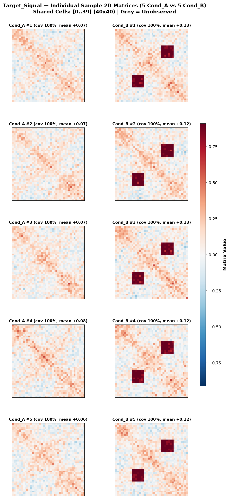
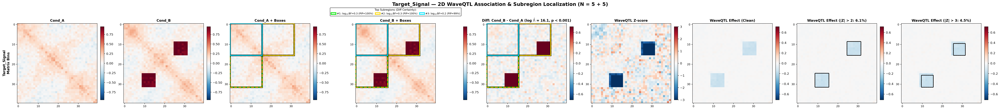

# WaveQTL-2D Documentation

**WaveQTL-2D** is a lightweight prototype wrapper around [WaveQTL (Shim & Stephens, 2015)](https://github.com/heejungshim/WaveQTL) for testing and localising spatial differences between two conditions across multiple samples of **2D symmetric matrices**.

---

## 1. Installation

### Prerequisites (C++ Compiler & GSL)
The C++ WaveQTL engine requires `g++`, `make`, and the GNU Scientific Library (GSL):

```bash
# Ubuntu / Debian / WSL
sudo apt-get update && sudo apt-get install -y build-essential libgsl-dev

# macOS (Homebrew)
brew install gsl
```

> **Note for macOS / dynamic GSL**: If the linker reports missing static libraries (`-lgsl` / `-lc` with `-static`), remove `-static` on line 35 of `src/Makefile` (and add `-std=gnu++14` if compiling with modern Clang) prior to installing.

### 1-Step Installation
Running `pip install .` automatically builds the C++ `WaveQTL` engine under the hood via `make all` and packages it into the Python wheel:

```bash
pip install .
```

Verify that the CLI is installed and ready:

```bash
waveqtl-2d --help
```

---

## 2. Input Format (`.tsv` / `.tsv.gz`)

Pass a tab-separated coordinate table containing pre-binned per-sample 2D matrices across two conditions. Upper-triangular (`cell_i <= cell_j`) or full symmetric coordinates are both supported.

```text
target          condition   sample   cell_i   cell_j   value
Target_Signal   Cond_A      1        0        0        0.2415
Target_Signal   Cond_A      1        0        1        0.1982
...
```

- **Automatic Alignment**: When the two conditions cover slightly different coordinate bounds, `WaveQTL-2D` automatically crops each comparison to the shared `[start_cell, end_cell]` intersection and pads to a dyadic $2^J \times 2^J$ grid (minimum $64 \times 64$).
- **Flexible Column Mapping**: Existing `.tsv` / `.tsv.gz` files with different column headers can be passed directly without editing the data file:
  - `--group-by <col1> [<col2> ...]` (default: `target`; when 2+ columns are given, rows sharing `<col1>` are stacked into a multi-row comparison figure)
  - `--cond-col <col>` (default: `condition`)
  - `--sample-col <col>` (default: `sample`)
  - `--row-col <col>` / `--col-col <col>` (defaults: `cell_i`, `cell_j`)
  - `--val-col <col>` (default: `value`)

---

## 3. Running WaveQTL-2D

### Smoke Test with Synthetic Data

```bash
# 1. Generate synthetic 2D matrices (Target_Null and Target_Signal)
python examples/generate_toy_data.py --output examples/data/toy_2d_matrices.tsv.gz

# 2. Run preparation, sample plotting, WaveQTL permutations, and result visualisation
waveqtl-2d \
  --input examples/data/toy_2d_matrices.tsv.gz \
  --output-dir examples/output \
  --num-perm 1000
```

### Useful Options
- `--cond1 Cond_A --cond2 Cond_B`: Explicitly fix condition order (`0.0` vs `1.0`, where `Diff = cond2 - cond1`).
- `--full-matrix-tsv <file>`: Optional unpartitioned condition-level 2D matrix TSV(.gz) used to render Columns 1–5 of the comparison figure (defaults to averaging across samples).
- `--vmax <float>`: Fix symmetric heatmap limits to `[-vmax, +vmax]`.
- `--num-perm 0`: Skip permutations and compute analytical Bayes Factors / posterior reconstructions only.

---

## 4. Output Visualisations & Tables

Running `waveqtl-2d` populates `--output-dir` with:

### A. Individual Sample Matrix Grids (`sample_plots/<comparison>_samples.png`)
Displays every individual sample's 2D matrix side-by-side across the two conditions (with unobserved bins shaded grey) to check coverage and sample-to-sample variability.



### B. 9-Column WaveQTL Comparison Figure (`comparison_<target>.png`)
Shows per-condition reference matrices (Cols 1–2), Top-3 localized dyadic subregions ranked by $\log_{10}\text{BF}$ (Cols 3–4), empirical difference with overall $\log \hat{\Lambda}$ and permutation $p$-value (Col 5), reconstructed data-space $Z$-scores (Col 6), and shrunk data-space posterior effect estimates with $|Z| > 2$ and $|Z| > 3$ contours (Cols 7–9).



---

## Citation & License

Distributed under **GPLv3+**. Based on:
- Heejung Shim and Matthew Stephens (2015). *Wavelet-based genetic association analysis of functional phenotypes arising from high-throughput sequencing assays*. Ann. Appl. Stat. 9(2), 665–686.
